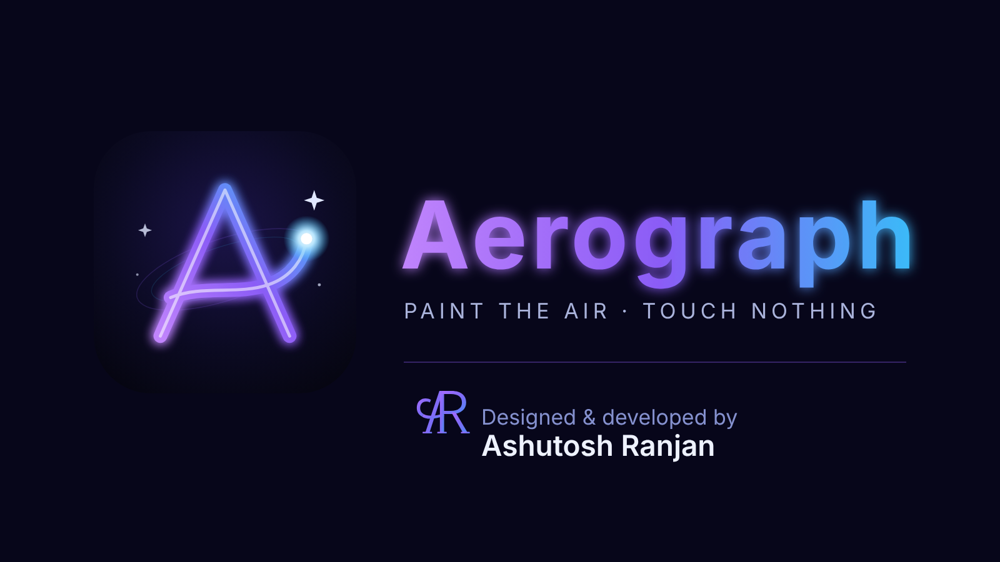
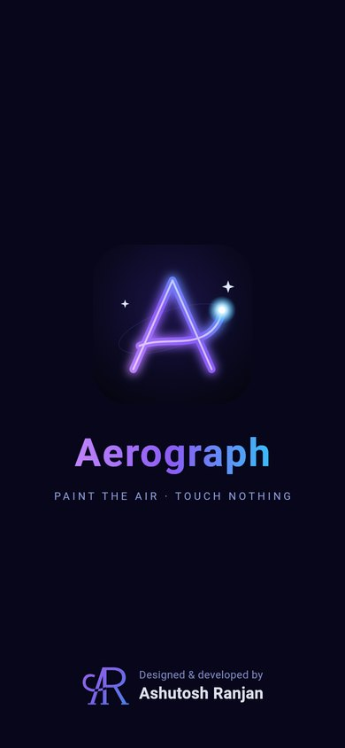
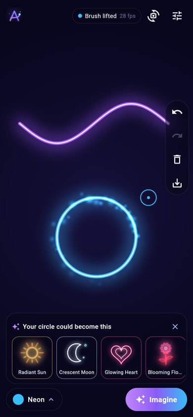
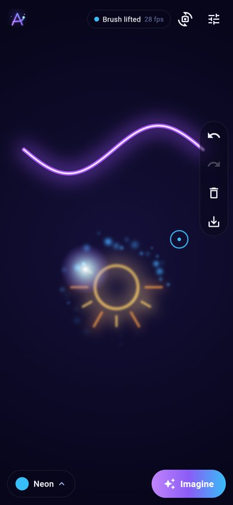
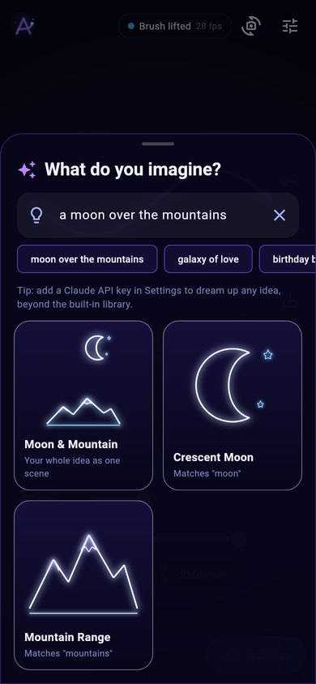
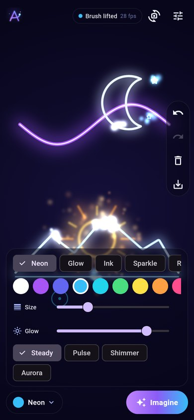

# Aerograph

<p align="center">
  
</p>

**Paint the air. Touch nothing.** Aerograph turns your phone camera into a brush you never touch:
your fingertip paints strokes in the air, the app tracks them in real time, and renders them as light.

Designed & developed by **Ashutosh Ranjan**.

| Splash | Sketch → suggestions | Magic build | Imagine | Scene built |
|---|---|---|---|---|
|  |  |  |  |  |

_Screens rendered from the real widgets with a simulated hand (`test/tool/screens_render_test.dart`); the camera feed is replaced by the night background._

## Features

- **Air painting.** On-device hand tracking (MediaPipe Hand Landmarker, 21 landmarks) follows your index fingertip through the front or back camera.
- **Gestures.** Index finger up paints; two fingers up lifts the brush; open palm held ~1 s undoes. Optional pinch-to-paint mode.
- **Depth-sensitive width.** Move your hand closer for thicker light, farther for fine lines.
- **Colors and lights.** Six brushes (Neon, Glow, Ink, Sparkle, Rainbow, Comet), ten swatches, size and glow intensity, camera dimming, and four light modes for finished strokes (Steady, Pulse, Shimmer, Aurora).
- **Imagine.** Type what you imagine ("a moon over the mountains", "birthday balloons at night"). Aerograph recommends art from a 31-piece light-art library, composes multi-idea scenes (sky / center / ground layers) and applies mood palettes (night → cosmic, sunset → warm, ocean → aqua…). Pick one and it **builds itself on the camera view**, stroke by stroke, behind a travelling spark.
- **Sketch-to-art.** Draw a rough circle, triangle, wave, zigzag or spiral in the air; Aerograph recognizes the shape and offers to transform it (circle → sun, moon, heart, flower…).
- **Dream anything (optional).** With your own Anthropic API key, Claude turns any idea into line art that the magic builder animates. The key is kept in the iOS Keychain / Android Keystore and sent only to `api.anthropic.com`. Everything else works offline.
- **Save.** Export "light only" or "light + camera photo" to the gallery (Aerograph album).
- **Touch fallback.** You can also paint with a finger on the screen.

## Branding

| Asset | File |
|---|---|
| App icon (vector) | `branding/aerograph_icon.svg`, `branding/aerograph_icon_1024.png` |
| Android adaptive icon foreground | `branding/aerograph_icon_foreground.svg` |
| Logo lockup with author credit | `branding/aerograph_logo.svg`, `branding/aerograph_logo.png` |
| AR signature (original) | `branding/ar_signature_original.jpg` |
| AR signature (vector recreation) | `branding/ar_signature.svg`, `branding/ar_signature_512.png` |

The mark is a single continuous stroke of light that paints an "A" and sweeps out to a glowing fingertip, in the violet→sky gradient of the AR signature. The splash screen, About screen and exported images carry the credit _"Designed & developed by Ashutosh Ranjan"_ with the AR monogram.

## Architecture

```
lib/
  main.dart                 app entry, portrait lock, theme
  app/settings.dart         persisted preferences; API key in secure storage
  tracking/
    air_tracker.dart        camera stream → native landmarker → smoothed screen pointer
    hand_pose.dart          rotation-invariant gesture classifier + debouncer
    frame_mapper.dart       analysis frame → preview (cover) → screen (cover) mapping
    one_euro_filter.dart    jitter-free, low-lag fingertip smoothing
  paint/                    brushes, palettes, strokes, undo history, light renderer
  magic/
    art_library.dart        31 parametric light-art templates (unit space)
    recommender.dart        imagination → ranked suggestions, scenes, mood palettes
    shape_recognizer.dart   air-sketch shape recognition
    magic_build.dart        lays art on screen and reveals it progressively
    claude_dream.dart       optional Claude structured-output line-art generator
  services/exporter.dart    off-screen render + save to gallery
  ui/                       splash, studio, imagine sheet, settings, about, brand painters
packages/aero_hand_tracker/ local Flutter plugin
  android/ …Plugin.kt       NV21 → downsampled ARGB → rotate → HandLandmarker (VIDEO mode)
  ios/ …Plugin.swift        BGRA → CVPixelBuffer → MPImage → HandLandmarker (video mode)
assets/models/hand_landmarker.task   MediaPipe model (float16, ~7.8 MB)
```

Frames are processed one at a time (a new frame is dropped while the previous is in flight), so tracking self-throttles to what the device can sustain.

## Build and run

Requirements: Flutter 3.50+ (Dart 3.14), Android SDK 36 / API 24+ device, Xcode 16+ with CocoaPods for iOS 15+.

```bash
flutter pub get
flutter run                       # on a connected device
flutter build apk --release --split-per-abi
flutter build ipa                 # on macOS; runs pod install (MediaPipeTasksVision)
```

Hand tracking needs a real camera; on emulators/simulators you can still paint by touch.

### Tests

```bash
flutter analyze
flutter test                      # 43 unit tests: gestures, filter, mapping, strokes, recommender, shapes, magic, Claude parsing
# Visual harnesses (write PNGs when given an output path):
flutter test test/tool/gallery_render_test.dart --dart-define=OUT=/tmp/gallery.png
flutter test test/tool/screens_render_test.dart --dart-define=OUT_DIR=/tmp/shots
```

## Privacy

Camera frames are analysed on device and never uploaded. Only when you use "Dream with Claude" is the text of your idea sent to Anthropic, using your own key.

## Credits

- Concept, design and development: **Ashutosh Ranjan**
- Hand tracking: [MediaPipe Hand Landmarker](https://ai.google.dev/edge/mediapipe/solutions/vision/hand_landmarker) (Apache 2.0)
